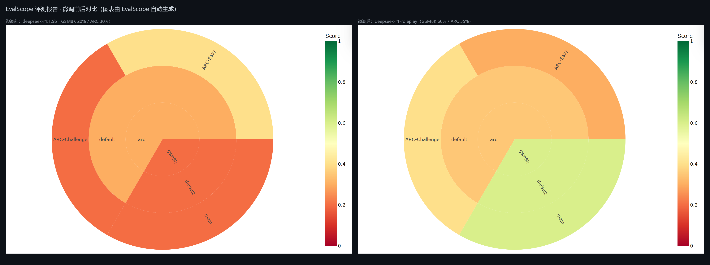

# 基于 DeepSeek-R1-1.5B 的二次元角色扮演垂域高效微调

> 仿照「基于 Qwen-3 的垂域大模型高效微调」项目思路，在 **Windows 单机（RTX 4060 Laptop 8GB）** 上复现垂域大模型高效微调全流程：
> 数据构建 → QLoRA 高效微调 → 权重合并 → Ollama 部署 → 对比评测与压测。

## 项目简介

面向**二次元角色扮演**垂域的 DeepSeek-R1-Distill-Qwen-1.5B 高效微调。在提升模型角色扮演能力（语气、性格、口癖还原）的同时，通过混合通用对话数据保留其通用能力，避免灾难性遗忘。

## 技术栈

- **微调**：Python、PEFT（LoRA/QLoRA）、TRL（SFTTrainer）、bitsandbytes（4bit NF4 动态量化）
- **部署**：Ollama（OpenAI 兼容 API，safetensors 直接导入）
- **评测**：自研对比评测脚本 + 压测脚本（吞吐 tok/s）

> 与原项目（Qwen3-14B + Unsloth + vLLM + EvalScope）的对照：Unsloth → PEFT/TRL（Unsloth 不支持 Windows 原生）；vLLM → Ollama；EvalScope → 自研评测脚本。QLoRA 核心技术路线不变。

## 目录结构

```
DeepSeek-R1-FT/
├─ model/                          # 基座模型 DeepSeek-R1-Distill-Qwen-1.5B（ModelScope 下载）
├─ data/
│  ├─ build_dataset.py             # 数据集构建：ChatHaruhi-54K + FineTome-100k，25/75 混合
│  └─ cleaned_roleplay_dataset/    # 混合后的训练数据集（datasets 格式）
├─ train/
│  ├─ finetune.py                  # QLoRA 微调（4bit 量化 + LoRA r=32，含显存/loss 记录）
│  ├─ merge.py                     # LoRA 合并导出 fp16
│  ├─ training_log.json            # 训练日志（loss 曲线、显存占用）
│  └─ checkpoints/                 # 训练过程文件
├─ weights/
│  ├─ lora_adapter/                # LoRA adapter 权重
│  └─ DeepSeek-R1-1.5B-roleplay-fp16/  # 合并后的 fp16 完整模型
├─ deploy/
│  └─ Modelfile                    # Ollama 导入配置（含 R1 对话模板）
├─ eval/
│  ├─ eval_compare.py              # 微调前后对比评测（角色扮演 + 通用防遗忘）
│  ├─ benchmark.py                 # 20 次请求压测（成功率 + tok/s）
│  ├─ make_dashboard.py            # （旧）matplotlib 仪表盘脚本，已被 EvalScope 原生报告替代
│  ├─ shot_dashboard.py            # 截取 EvalScope report.html 环图并拼成对比图
│  ├─ dashboard_outputs/           # EvalScope 报告目录（含自动生成的 report.html）
│  ├─ evalscope/                   # EvalScope 评测原始报告
│  └─ reports/                     # 对比报告、压测结果、dashboard.png
└─ requirements.txt
```

## 复现步骤

```powershell
# 1. 创建环境（Python 3.12）
python -m venv .venv
.venv\Scripts\python -m pip install -r requirements.txt
# torch 需 CUDA 版：
.venv\Scripts\python -m pip install --index-url https://mirrors.aliyun.com/pytorch-wheels/cu128 torch

# 2. 下载基座模型（约 3.4GB，ModelScope 国内源）
.venv\Scripts\python -c "from modelscope import snapshot_download; snapshot_download('deepseek-ai/DeepSeek-R1-Distill-Qwen-1.5B', local_dir=r'model/DeepSeek-R1-Distill-Qwen-1.5B')"

# 3. 构建混合数据集（25% 角色扮演 + 75% 通用对话）
.venv\Scripts\python data\build_dataset.py

# 4. QLoRA 微调
.venv\Scripts\python train\finetune.py

# 5. 合并权重
.venv\Scripts\python train\merge.py

# 6. 导入 Ollama
ollama create deepseek-r1-roleplay -f deploy/Modelfile

# 7. 对比评测 + 压测
.venv\Scripts\python eval\eval_compare.py
.venv\Scripts\python eval\benchmark.py
```

## 实验结果

### 训练配置与结果

| 项目 | 数值 |
|---|---|
| 训练样本 | 10,000 条（2,500 角色扮演 + 7,500 通用对话，25%/75%） |
| 训练步数 | 625 步（1 epoch，effective batch = 2 × 8） |
| 量化方式 | 4bit NF4（bitsandbytes），LoRA r=32 |
| 训练显存峰值 | **6.35 GB / 8 GB**（RTX 4060 Laptop，单卡可训） |
| 训练时长 | 约 3 小时 59 分（4bit QLoRA，2048 序列长度） |
| Loss | 1.74 → 0.98（平稳收敛） |

### 微调前后对比（详见 `eval/reports/compare_report.md`）

| 用例 | 基座 `deepseek-r1:1.5b` | 微调后 `deepseek-r1-roleplay` |
|---|---|---|
| 凉宫春日 | 出戏，泛泛而谈 | 以「」口吻的角色台词，符合人设 |
| 御坂美琴 | 像百科问答，无角色感 | 角色口吻回答，带「」 |
| 韦小宝 | 直接拒答「我还没学会回答」 | 以韦小宝语气回怼，符合人设 |
| 数学推理（防遗忘） | 正确解出 x=-2 | 正确解出 x=-2 ✅ 未遗忘 |
| 日常对话 | 正常 | 略退化（重复堆叠），小模型小数据量的预期内代价 |

### EvalScope 基准评测（Dashboard）



| 数据集 | 基座 `deepseek-r1:1.5b` | 微调后 `deepseek-r1-roleplay` |
|---|---|---|
| GSM8K（数学推理） | 20% | **60%** |
| ARC（常识推理） | 30% | 35% |

> 评测方式：EvalScope 1.14（`openai_api` 模式）直连 Ollama 服务，每个数据集 10 条样本（limit=10，max_tokens=1024），
> 分数为主指标 Accuracy。上面两张环图（sunburst）是 **EvalScope 自动生成的评估报告**
> （`eval/dashboard_outputs/combined_*/reports/report.html` 中的 SCORE DISTRIBUTION 图表），
> 由 `eval/shot_dashboard.py` 用无头浏览器截取左右拼接，颜色随分数红→黄→绿变化。

### 压测（详见 `eval/reports/benchmark.json`）

| 指标 | 数值 |
|---|---|
| 请求数 | 20（`num_predict=256`） |
| 成功率 | **20/20 = 100%** |
| 吞吐 | **57.7 tokens/s**（RTX 4060 Laptop，Ollama 推理） |

## 使用微调后的模型

```powershell
ollama run deepseek-r1-roleplay
```

或走 OpenAI 兼容接口（`http://localhost:11434/v1`），把 `model` 设为 `deepseek-r1-roleplay`。

> 仓库内附带 LoRA adapter（`weights/lora_adapter`，81MB），可用 `train/merge.py` 与基座合并后复现；
> 合并后的 fp16 权重（3.4GB）与 GGUF（3.55GB）体积过大未入库，按上方「复现步骤」重新生成即可。


## 数据集

- [ChatHaruhi-54K-Role-Playing-Dialogue](https://huggingface.co/datasets/silk-road/ChatHaruhi-54K-Role-Playing-Dialogue)：54K 角色扮演对话（凉宫春日、御坂美琴等 32 个经典角色），CC-BY-4.0
- [FineTome-100k](https://huggingface.co/datasets/mlabonne/FineTome-100k)：通用对话，用于防止灾难性遗忘
